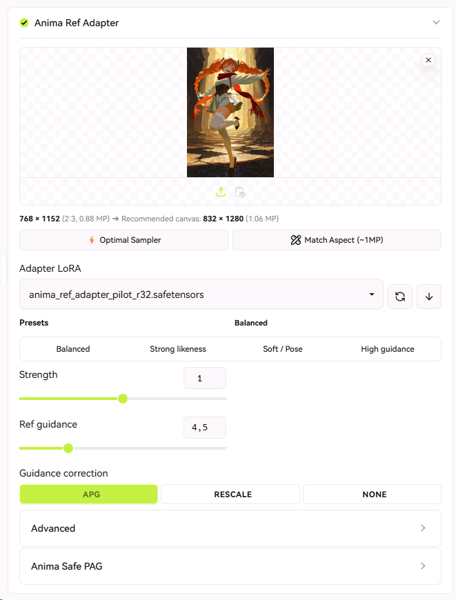
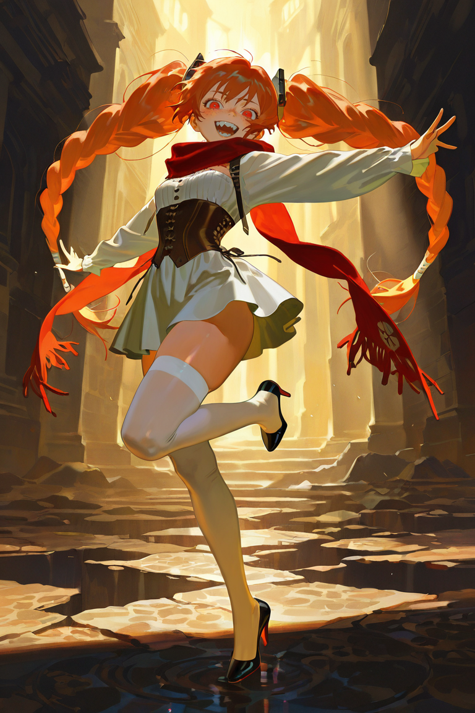
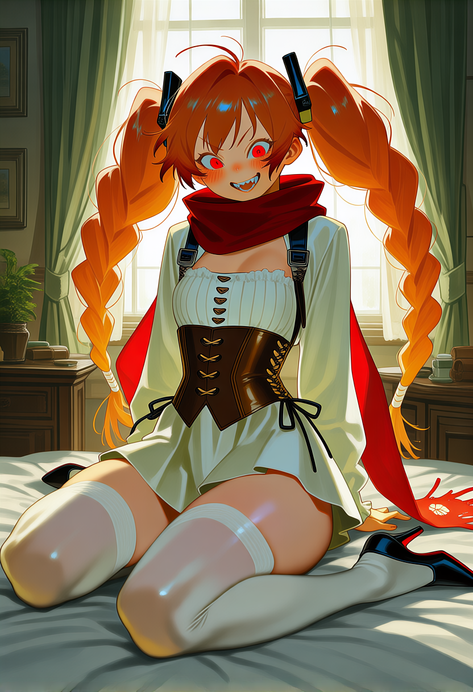
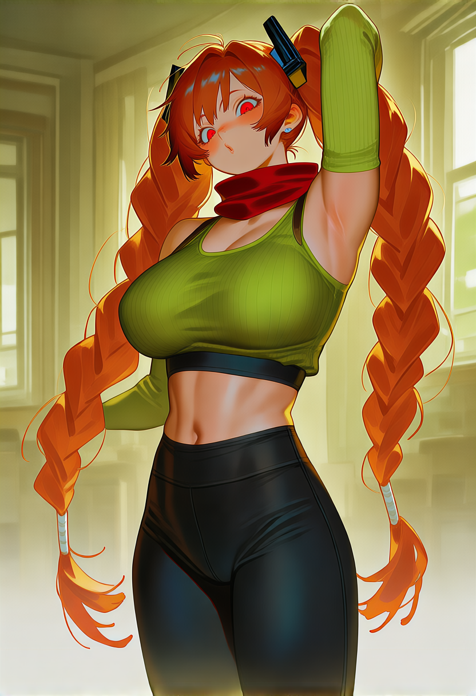
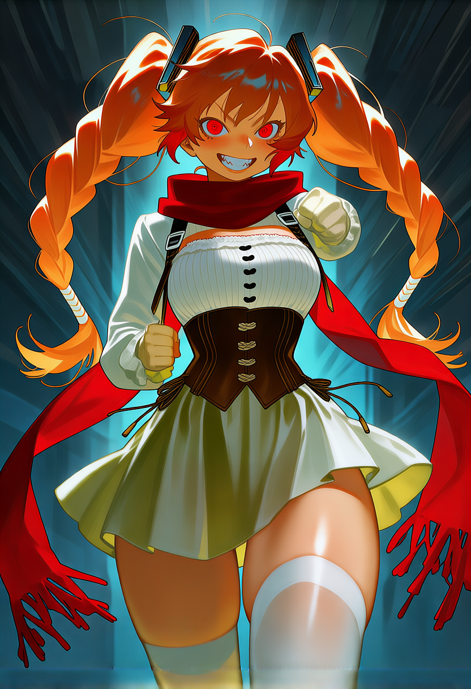

# Anima Ref Adapter for Forge-Neo

**Anima Ref Adapter** (`anima-ref-adapter-neo`) is a native extension for [Forge-Neo](https://github.com/Haoming02/sd-webui-forge-classic).

It ports **[ElectronGirl/ComfyUI-Anima-Ref-Adapter](https://github.com/ElectronGirl/ComfyUI-Anima-Ref-Adapter)** and **[Anima Safe PAG](https://github.com/iljung1106/comfyui-anima-safe-pag)** directly into Forge-Neo.

> **Character and style from one reference image; pose, place, and framing from your prompt.**

<p align="center">
  
  <br>
  <em>Interface running in Forge-Neo with the <a href="https://github.com/LeonWGal/lobe-theme-neo">Lobe Theme Neo</a> theme.</em>
</p>

---

## Comparison & Examples

The table below demonstrates zero-shot character transfer using Anima Ref Adapter:
* **Reference Image:** Generated using model **`betterDaysIllustrious`** (`betterDaysIllustriousXL_illuXLV02BAKEDVAE`).
* **Outputs:** Rendered using model **`rdbtAnima`** (`rdbtAnima_v30BaseSma_fp16`) with Anima Ref Adapter (`anima_ref_adapter_pilot_r32.safetensors`, Strength 1.0, Ref Guidance 4.5, APG).

> [!TIP]
> Notice how the generated images don't require character appearance tags in the prompt — identity, hair, outfit cues, and art style are transferred automatically from the reference image, while the prompt guides only the pose and action!

| Input Reference (`betterDaysIllustrious`) | Output 1 (`rdbtAnima`) | Output 2 (`rdbtAnima`) | Output 3 (`rdbtAnima`) |
| :---: | :---: | :---: | :---: |
|  |  |  |  |
| **Original Reference**<br/>*(betterDaysIllustrious)* | **`wariza, 1girl`**<br/>*(rdbtAnima)* | **`yoga pants, yoga, 1girl`**<br/>*(rdbtAnima)* | **`punching viewer, 1girl`**<br/>*(rdbtAnima)* |

---

## Features

- **Seamless Reference Conditioning:** Encodes the reference image via Wan 2.1 VAE with automatic letterboxing (`fill = 255`) and injects it as a second clean latent frame (`t = 0`).
- **RoPE Height Shift (`RoPE Offset H = 1.0`):** Shifts the reference frame's position coordinates, transferring identity and art style without pinning the original pose.
- **Multi-Reference Image Support (Up to 4 Slots):** Upload up to 4 reference images with individual slot weights and choose between:
  - `Multi-Frame Attention`: Injects each reference as its own frame in the 3D DiT, enabling the model to attend concurrently to multiple angles, face closeups, and outfit details.
  - `Latent Blend`: Computes a weighted linear interpolation across reference latents before conditioning.
- **Selective Adapter LoRA & Reference Guidance:** Applies pilot LoRA weights (`anima_ref_adapter_pilot_r32.safetensors`, rank 32) exclusively to reference branches (`pos`/`neg`) and unhooks them from the base branch, enabling high `Reference Guidance` (4.5–6.0).
- **Anti-Burn Guidance Corrections:** Supports Adaptive Projected Guidance (`apg`) and CFG `rescale` to tame color saturation at high guidance values.
- **Adaptive UI:** Clean native layout for standard Forge-Neo themes and optimized vertical stack for [lobe-theme-neo](https://github.com/LeonWGal/lobe-theme-neo).
- **Presets with Instant Feedback:** Quick buttons (`Balanced`, `Strong likeness`, `Soft / Pose`, `High guidance`) with real-time active state badge.
- **Optional Anima Safe PAG:** Perturbed-Attention Guidance on Anima DiT blocks for crisper line art and fine details.
- **Workflow Shortcuts:** 1-click optimal sampler configuration (`Euler`, `Simple`, `28 steps`, `CFG 4.5`), `~1MP` aspect ratio matching, and live letterbox preview.

---

## Installation

### Method 1: Via Forge-Neo Extensions Tab
1. Open Forge-Neo WebUI -> **Extensions** -> **Install from URL**.
2. Paste:
   ```text
   https://github.com/LeonWGal/anima-ref-adapter-neo
   ```
3. Click **Install**, then **Apply and restart UI**.

### Method 2: Manual Clone
```bash
cd <Forge-Neo-Root>/extensions
git clone https://github.com/LeonWGal/anima-ref-adapter-neo sd-forge-anima-ref-adapter
```

---

## Adapter Weights

Download the pilot LoRA **[`anima_ref_adapter_pilot_r32.safetensors`](https://huggingface.co/ElectronGirl/anima-ref-adapter/blob/main/anima_ref_adapter_pilot_r32.safetensors)** and place it into:
```text
extensions/sd-forge-anima-ref-adapter/models/anima_ref_adapter_pilot_r32.safetensors
```
*(Or simply click the download button in the extension interface — it will automatically download and verify the weights directly into the extension models directory.)*

---

## Recommended Generation Settings

| Setting | Recommended Value | Notes |
|---|---|---|
| **Model** | Anima Base v1.0 / `rdbtAnima` | Standard prompt LoRAs `<lora:...>` work normally |
| **Sampler / Scheduler** | `Euler`, `Simple` / `Normal`, `28–32` steps | Avoid stochastic samplers (SDE, Ancestral) to prevent digital noise |
| **CFG Scale** | `4.0 – 4.5` | Main text CFG |
| **Reference Guidance** | `4.5 – 6.0` | `1.0` = normal CFG; `4.5–6.0` = strong identity & style lock |
| **Guidance Correction** | `apg` | Or `rescale` (`Rescale Phi = 0.5`) to prevent over-saturation |
| **RoPE Offset H** | `1.0` | Training default |
| **Letterbox Fill** | `255` | 255 = white padding (training default) |
| **Anima Safe PAG** *(optional)* | `Scale = 1.3`, `Block = 18`, `Strength = 0.75` | Extra sharpness |

### Prompting Guide
- **Do not** specify character names, artist names, or visual tags already present in the reference image.
- Only describe the **new scene**, pose, framing, lighting, and general quality:
  ```text
  wariza, 1girl, masterpiece, best quality, solo
  ```

---

## License

- Extension code: **Apache-2.0**
- Original nodes: [ElectronGirl/ComfyUI-Anima-Ref-Adapter](https://github.com/ElectronGirl/ComfyUI-Anima-Ref-Adapter) (Apache-2.0)
- Model adapter weights are distributed under the **CircleStone Non-Commercial License**.
